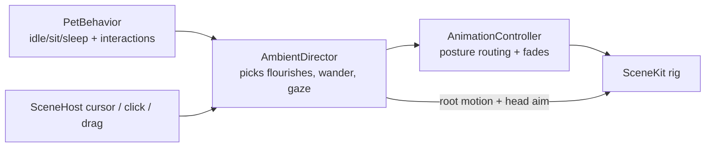

# Aliveness plan — the Shiba moves on its own

**Outcome:** the dog looks alive with zero menu clicks. Left alone on the desktop it fidgets, looks around, yawns, stretches, scratches, shakes, wanders, and reacts to the cursor — all from the 24 authored clips, driven by its needs and the time of day.

**Done when:** a 10-minute unattended recording of the panel shows no identical 30-second window, every autonomous transition uses an authored clip with no pop, idle CPU stays under 3 %, and David accepts the feel.

## Why it looks dead today

Evidence from `mac/Sources/PetKit`:

- `PetBehavior.resolveAutonomousActivity` returns only `.idle`, `.sit`, `.sleep` — three states.
- `AnimationController.profile(for:)` maps those to exactly three held loops (`shiba_idle_loop`, `shiba_sit_idle_loop`, `shiba_sleep_loop`) plus `shiba_beg_loop` when a care request is pending.
- Nine authored one-shots and two loops are never reached autonomously: `stretch`, `yawn`, `scratch`, `look_around_loop`, `alert`, `shake`, `bark`, `happy`, `walk_loop`, `run_loop`, `fetch_*`. Only menu/preview shows them.
- Root is fixed in every clip (`blender/CLIPS_RESULT.md`: "in place, fixed root"), so the dog never changes position or facing.
- Nothing reacts to the cursor except click (call) and drag (pet).

So the visible behaviour is: one loop, forever, in one spot. Correct simulation, no life.

## Design principle

Keep `PetBehavior` as the source of truth for *what the dog needs* (deterministic, persisted, tested). Add a separate **ambient layer** that decides *what the dog does with its body while in a state*. Ambient choices are visual, never persisted, and never change needs — they can be re-rolled at any time without corrupting save data. Same split as body/face in games: logic state vs. performance.

## Phase 1 — Fidget scheduler (biggest payoff, ~1 day)

**New:** `PetKit/AmbientDirector.swift`, seeded RNG injected for tests.

While the logical activity is a held state, the director schedules a one-shot "flourish" every 8–25 s (random, need-weighted), plays it via `AnimationController`, and returns to the state's loop. Pools by posture, taken from the clip pose table in `blender/CLIPS_RESULT.md`:

| Logical state | Held loop | Flourish pool (all start and end in that posture) |
| --- | --- | --- |
| idle (standing) | `shiba_idle_loop` ⇄ `shiba_look_around_loop` | `shiba_yawn`, `shiba_shake`, `shiba_alert`, `shiba_bark`, `shiba_happy` |
| sit | `shiba_sit_idle_loop` | `shiba_scratch` (seated), `shiba_yawn` |
| sleep | `shiba_sleep_loop` | none — but a rare `shiba_wake` → `shiba_sleep_loop` "stir" (sit up, look, lie back) every 2–4 min |
| beg (care request) | `shiba_beg_loop` | `shiba_bark` every 20–40 s (the dog asks louder) |

Need weighting (multiplies base pick probability):

- energy < 40 → `yawn` ×3, `stretch` on next stand-up
- fun < 40 → `happy` ×0, `look_around` ×2 (bored, scanning)
- fun > 70 or affection > 70 → `happy` ×2, `bark` ×1.5
- cleanliness < 40 → `shake` ×3, `scratch` ×3
- night (22–07) → all standing flourishes ×0.3, prefers sit/sleep (already in `PetBehavior`)

Also swap the held loop itself: in idle, alternate `shiba_idle_loop` and `shiba_look_around_loop` on a 20–40 s cadence so even the "base" pose is not a single loop.

**Wake-up route change:** when leaving `sleep` toward standing, use `shiba_stretch` (authored lying→standing, 105 f) instead of `wake` + `stand_from_sit` about half the time. Both routes are valid per the contract; `AnimationController.route(from:to:)` gets a `variant` parameter.

**Controller changes:**

- `AnimationController.playFlourish(named:)` — a one-shot that returns to `currentClip` on completion, keeping `currentActivity` and `currentPosture` unchanged. Reject if the clip's start posture ≠ `currentPosture` (posture table becomes data on each clip, not just `_loop` suffix).
- Interactions (`eat`, `pet`, `call` …) preempt any flourish immediately; existing `play()` already blend-outs the active step, so nothing new is needed there except cancelling the director's pending timer.
- Cooldown per clip (no `yawn` twice within 60 s) and global minimum gap 6 s between flourishes so the dog is not hyperactive.

**Tests (`AmbientDirectorTests`):** with a seeded RNG, over 600 simulated seconds in idle the director emits between 24 and 75 flourishes, never two within 6 s, never one whose posture ≠ current posture, never any while an interaction is running, and the low-energy weighting produces more `yawn` than the high-energy run.

## Phase 2 — Wander with root motion (~1 day)

The walk/run cycles are fixed-root. Move the node procedurally: the director picks a target x inside the panel (keep y fixed, z within ±0.15 of camera plane), rotates the model to face it (yaw only, 0.3 s eased), plays `shiba_walk_loop`, and translates the root at a speed matched to the cycle's stride so feet do not slide. Stride is measured once: distance a forepaw travels in one cycle in the authored clip (read from the `.dae` on first load, cached). On arrival, blend to idle.

- Trigger: idle only, fun < 60 or every 45–120 s at random; never within 3 s of a click.
- `shiba_run_loop` when fun > 75 and the target is > 60 % of panel width away — a happy burst.
- Bowl interaction: when hunger/thirst request is pending, wander target = bowl position, then `beg_loop` facing the camera. The bowl is already a node in `SceneHost`.
- Panel edges: clamp targets to the SceneKit view frustum at dog depth; `SceneHost` exposes `walkableBounds`.
- Shadow blob follows the root (already parented? verify in `SceneHost.setPet`).

**Test:** deterministic target sequence; root never leaves `walkableBounds`; facing is always toward velocity; on interaction mid-walk, root motion stops within one frame and posture routing still resolves from `standing`.

## Phase 3 — Cursor awareness (~half day)

Cheap, huge perceived-life gain.

- **Gaze:** `SceneHost` tracks the mouse via a global `NSEvent` monitor (no activation needed; panel is non-activating). Convert to a point at dog depth; the director aims `neck`/`head` with a small additive rotation (≤ 20° yaw, ≤ 10° pitch, spring-eased) on top of whatever clip plays. Only when the cursor is within ~1.5 panel-widths; otherwise ease back to clip pose. Disabled during `sleep`, `eat`, `drink`.
- **Approach:** cursor hovers over the dog for > 1.5 s → `shiba_alert`, then if still hovering, `shiba_happy` and a small tail wag boost (affection +1 per 10 s of attention, capped).
- **Cursor leaves after long attention** → `shiba_look_around_loop` once (looks for you).

Additive head aim must respect the rigid-skinning rule (`docs/ANIMATION_CONTRACT.md`): apply the rotation on `head` (not `neck`) with the ≤ 20° cap so the body-adjacent joint stays under its seam limit.

## Phase 4 — Idle-time and presence rhythm (~half day)

- After 20 min with no interaction, drift to `sit`, then `sleep`, even by day — a dog left alone naps. Encode in `PetBehavior` as a `lastInteractionAt` field (persisted) feeding `sleepUtility`.
- On wake from system sleep or display unlock (`NSWorkspace.didWakeNotification`, `sessionDidBecomeActive`) → if sleeping: `wake` → `alert` → `happy` greeting sequence; if awake: `alert` toward camera. This is the "dog notices you came back" moment.
- Time-of-day flourishes: morning first-sight `stretch` + `shake`; evening `yawn` bias ×2 after 20:00.

## Phase 5 — Sound (optional, ~half day)

Short bark/yawn/shake samples from `public/assets` (already ripped) played on the matching flourish at low volume, respecting a mute toggle in `StatusMenu`. Off by default until David hears it.

## Order and proof

1. Phase 1 ships first — it alone changes the app from "one loop" to "a dog doing things".
2. Phase 3 next — cursor gaze is the cheapest "it sees me" effect and needs no new clips.
3. Phase 2 wander, then Phase 4 rhythm, then sound.

Proof for each phase: headless bundled smoke records 60 s of `currentClip` transitions with a seeded director and asserts the expectations above; a 10-minute screen recording of the real panel (`screencapture -v` on the window id, no focus change) reviewed by David for feel. Tune constants live from a debug "Ambient" submenu (frequency multiplier, wander on/off) so tuning is a menu tweak, not a rebuild.

## Not in scope

- New Blender clips. Everything above uses the 24 already authored. If Phase 1 reveals a gap (e.g. a sit-posture `look_around`), that becomes one prompt to the Windows session, not a blocker.
- Fetch depth and park walk (U7/U8) — separate plan.
- Persisting ambient state — deliberate; only needs persist.

## Cost

Phases 1–4 ≈ 3 days of Mac-side work, no Windows dependency. Risk: root-motion foot sliding in Phase 2 if stride measurement is off — mitigated by measuring from the clip, not guessing, and by walking slowly.
